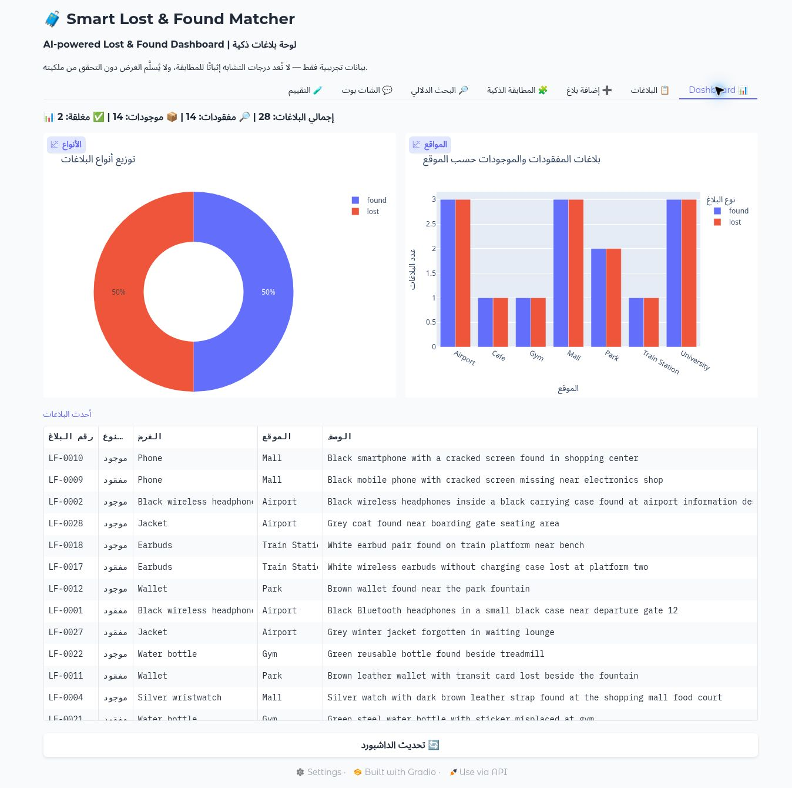
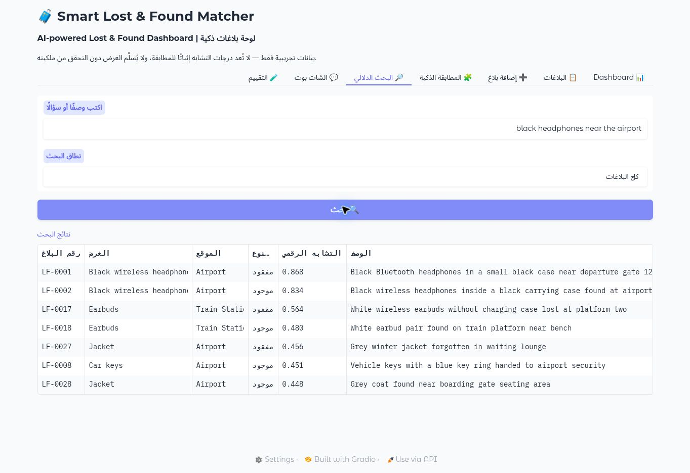
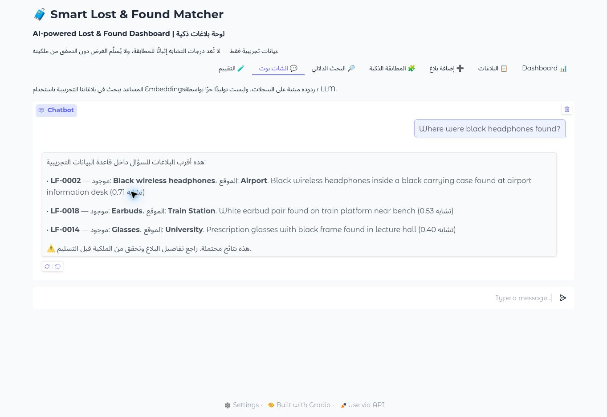

# Smart Lost & Found Matcher

A bilingual lost-and-found dashboard that helps people explore reports and find potentially matching items using semantic search.

[](https://colab.research.google.com/github/Shatha-algobaishi/smart-lost-found-matcher/blob/main/Smart_Lost_Found_AI_Dashboard.ipynb)

## Dashboard



The demo starts with **28 synthetic reports** across seven locations: 14 lost items, 14 found items, and two resolved reports.

## Features

- **Dashboard:** report totals, location breakdowns, report distribution, and a report table.
- **Report management:** add reports, browse records, and filter by type or status.
- **Suggested matches:** retrieve reports of the opposite type and boost matches from the same location.
- **Semantic search:** search item descriptions using multilingual sentence embeddings.
- **Retrieval chatbot:** ask questions in Arabic or English and get relevant report details.
- **Evaluation:** inspect Hit Rate@3 and MRR@3 across five predefined demo queries.
- **Persistence:** store reports and conversation history in SQLite and embeddings in ChromaDB.

## Semantic search



Search encodes the query with `paraphrase-multilingual-MiniLM-L12-v2`, then retrieves similar reports from ChromaDB using cosine distance. Matching restricts results to the opposite report type and adds a small same-location ranking bonus.

## Chatbot



The chatbot uses a real embedding model and formats answers from retrieved records. It does **not** use an LLM for free-form generation, and no API key is needed. The embedding model downloads on the first run.

## Run in Google Colab

1. Click **Open in Colab** above.
2. Select **Runtime → Run all**.
3. Wait for dependencies and the embedding model to download.
4. Open the Gradio link shown in the final cell.

The default Colab database is temporary. To keep reports across Colab sessions, set `SAVE_TO_DRIVE = True` before running the setup cell and authorize your own Google Drive connection. The Gradio share link is public while the session is running; use synthetic data when sharing the demo.

## Run locally

Use Python 3.11 or 3.12 in a virtual environment:

```bash
git clone https://github.com/Shatha-algobaishi/smart-lost-found-matcher.git
cd smart-lost-found-matcher
python -m venv .venv
```

Activate the environment (`source .venv/bin/activate` on macOS/Linux or `.venv\Scripts\activate` on Windows), then run:

```bash
pip install -r requirements.txt
python app.py
```

Open the local URL printed in the terminal. Local data is saved in `data/`, which is excluded from Git. Set `LOST_FOUND_DATA_DIR` to use another data directory. Public sharing is disabled in the local script unless `GRADIO_SHARE=true` is set.

## Technology

| Layer | Tools |
| --- | --- |
| Interface | Gradio |
| Charts and tables | Plotly, pandas |
| Reports and chat history | SQLite |
| Vector search | ChromaDB |
| Embeddings | Sentence Transformers, multilingual MiniLM |
| Notebook | Jupyter / Google Colab |

## Project files

| File | Purpose |
| --- | --- |
| `Smart_Lost_Found_AI_Dashboard.ipynb` | Guided Colab notebook with Arabic explanations |
| `app.py` | Local Python application using the notebook's workflow |
| `requirements.txt` | Required Python packages |
| `assets/screenshots/` | Screenshots from the running demo |

## Validation

On the initial synthetic dataset, all five predefined queries retrieved their expected report at rank 1 (**Hit Rate@3: 100%, MRR@3: 1.00**). Adding a report, updating its status, filtering resolved reports out of search, opposite-type matching, and a chatbot retrieval response were also checked. These results describe the demo dataset only.

## Demo scope

All sample reports and names are fictional. Similarity scores are ranking signals, **not ownership probabilities**. Verify ownership before returning an item. This educational prototype has no authentication or production access controls. The five-query evaluation is a small retrieval check, not a general accuracy benchmark. Status changes are available through the Python function `change_status`; the current interface does not expose a status-editing control.
